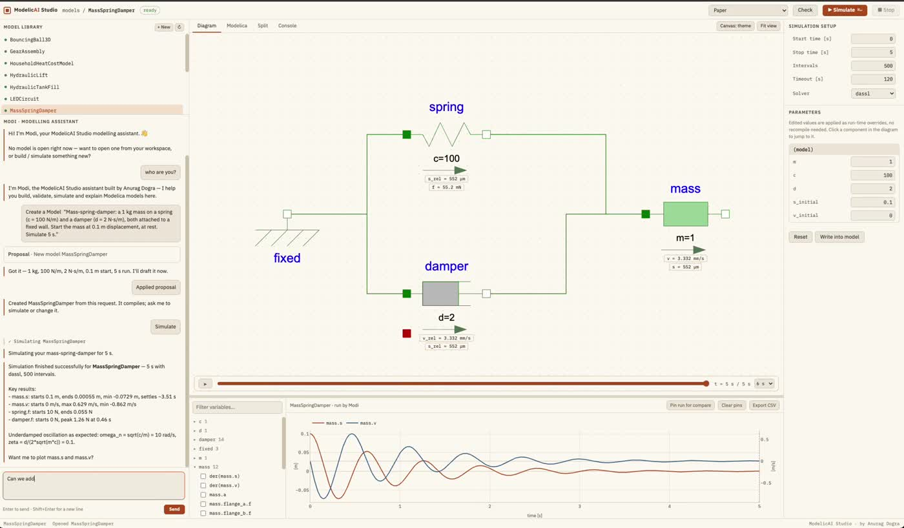
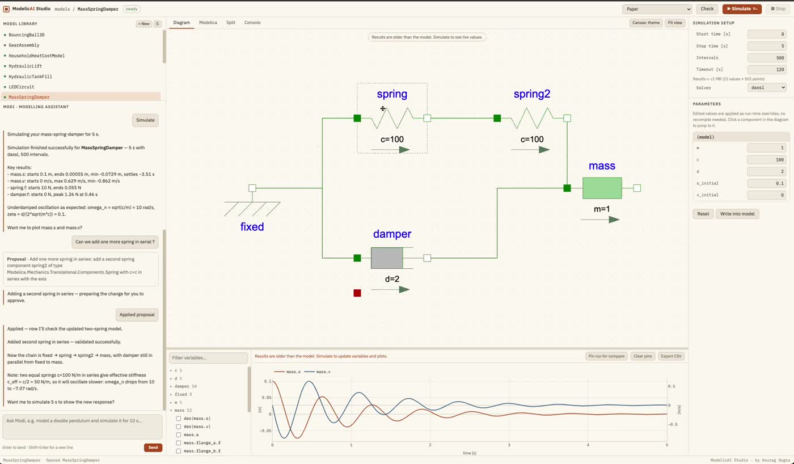
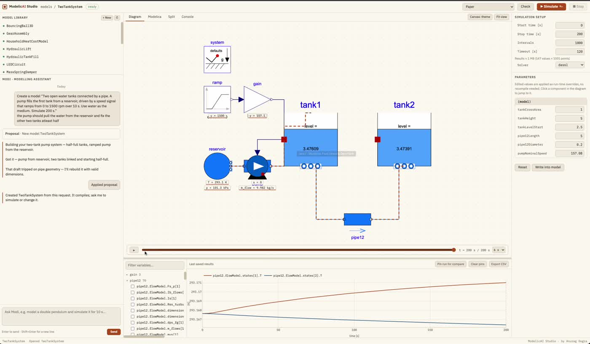
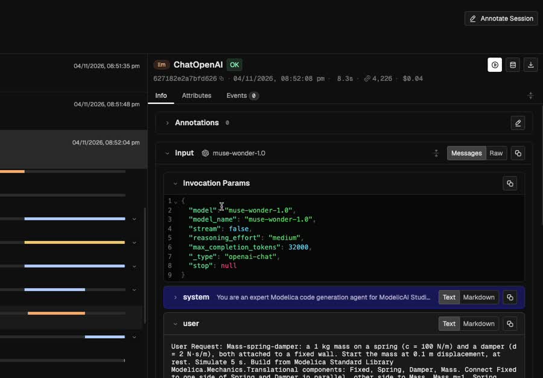

<div align="center">

# ModelicAI Studio

### From a sentence to a verified simulation.

**Verifiable AI agents for physical systems, built on Meta Muse and OpenModelica.**

[](LICENSE)




</div>

---

## Why

Modelling physical systems in Modelica is powerful, but hard to get into:

| The pain | How ModelicAI Studio solves it |
|---|---|
| **Hours of wiring** components by hand | Describe the system in plain English; Muse builds it |
| **A steep learning curve**, know-how sits with a few experts | Modi explains every step and every result |
| **Exact names**: one wrong parameter and nothing compiles | A **knowledge graph of the real Modelica library** checks every model before it runs |
| **Cryptic solver errors** | The exact variable and value that failed, then an automatic fix |
| **Runaway simulations** that freeze your tools | Progress, timeout, size cap and a Stop button |
| **AI output you can't trust** | Library check, compile, test run, your approval, and full traces |

## How it works

```
 You ──► Modi (Muse Spark 1.3) ──► Designer (Muse Wonder 1.0) ──► Library check ──► Compile ──► Test run ──► You approve ──► Simulate
                                        ▲                                                        │
                                        └──────────── exact failure cause, up to 5 attempts ─────┘
```

- **Modi** (Meta **Muse Spark 1.3**) is your modelling assistant: it plans, explains, and calls the tools.
- **The designer** (Meta **Muse Wonder 1.0**, medium reasoning) writes Modelica from the real **Modelica Standard Library 4.1.0**.
- **The MSL knowledge graph** (4,606 classes, 23,668 parameters and connectors) catches invented classes, modifiers and connectors *before* OpenModelica ever runs.
- **OpenModelica** compiles and test-runs every draft. Nothing reaches your workspace unverified, and nothing is applied without your approval.
- **Arize Phoenix** traces every agent step, model call and tool call.

## See it run

| Ask for a change, review it, apply it | Live values on a fluid system |
|---|---|
|  |  |

<p align="center"><br><sub>Every Muse call traced in Arize Phoenix</sub></p>

## Quick start

You need **Docker** and a **Meta Model API key**.

```bash
git clone https://github.com/anuragdogra2192/ModelicAI.git
cd ModelicAI

# Build the web app (served by the backend at /studio)
cd frontend && npm install && npm run build && cd ..
```

### Option A: Docker Compose (one command)

```bash
echo "MODEL_API_KEY=your-meta-api-key" > .env
docker compose up --build
```

### Option B: Docker, step by step

```bash
export MODEL_API_KEY=your-meta-api-key

# Build the image (OpenModelica + Modelica Standard Library 4.1.0, takes a few minutes)
docker build -t modelicai-engine .
# Clean rebuild from scratch: docker build --no-cache -t modelicai-engine .

# A network shared by Studio and Phoenix
docker network create modelicai-net   # once; skip if it already exists

# Arize Phoenix for tracing (optional, but recommended)
docker run -d --rm --name phoenix --network modelicai-net -p 6006:6006 arizephoenix/phoenix:latest

# ModelicAI Studio
docker run -it --rm --name modelicai \
  --network modelicai-net -p 8000:8000 \
  -v "$(pwd)":/app \
  -e LLM_PROVIDER=meta \
  -e META_MODEL=muse-wonder-1.0 \
  -e MODI_MODEL=muse-spark-1.3 \
  -e META_REASONING_EFFORT=medium \
  -e DESIGN_MAX_RETRIES=5 \
  -e MODEL_API_KEY \
  -e PHOENIX_COLLECTOR_ENDPOINT=http://phoenix:6006/v1/traces \
  -e PHOENIX_API_KEY \
  -e GIT_COMMIT=$(git rev-parse --short HEAD) \
  modelicai-engine
```

Open **http://localhost:8000** for the Studio and **http://localhost:6006** for the Phoenix traces.

The library knowledge graph builds itself in the background on first start.

## Try it now

Paste this into the Modi chat:

> **Mass-spring-damper:** a 1 kg mass on a spring (c = 100 N/m) and a damper (d = 2 N·s/m), both attached to a fixed wall. Start the mass at 0.1 m displacement, at rest. Simulate 5 s.

Click **Apply**, then ask **"Simulate"**. You get a damped oscillation, live values on the diagram, and Modi's explanation.

Then ask for a change:

> Can we add one more spring in series?

More prompts to try:

> **Two tanks:** two open water tanks connected by a pipe. A pump fills the first tank from a reservoir, driven by a speed signal that ramps from 0 to 1500 rpm over 10 s. Use water as the medium. Simulate 200 s.

> **DC motor:** a DC motor driving an inertia through a gearbox (ratio 10), powered by a 12 V step. Plot current and speed. Simulate 2 s.

> **RC circuit:** a 10 V step source charging a 1 mF capacitor through a 1 kΩ resistor. Simulate 5 s.

## Configuration

| Variable | Default | What it does |
|---|---|---|
| `MODEL_API_KEY` | (required) | Meta Model API key |
| `LLM_PROVIDER` | `meta` | Model provider |
| `MODI_MODEL` | `muse-spark-1.3` | Model for Modi |
| `META_MODEL` | `muse-wonder-1.0` | Model for the designer and simulation agent |
| `META_REASONING_EFFORT` | `medium` | Reasoning effort for Muse |
| `DESIGN_MAX_RETRIES` | `5` | Design attempts before giving up |
| `SIM_TIMEOUT_S` | | Simulation timeout |
| `MAX_RESULT_MB` | | Result size cap |
| `PHOENIX_COLLECTOR_ENDPOINT` | | Turns on tracing to Arize Phoenix |
| `PHOENIX_API_KEY` | | Only needed for a hosted Phoenix |

## Roadmap

- **Report generation agent:** the visualization agent becomes a report agent that turns a finished simulation into a shareable engineering report, with the model diagram, key plots, the settings used, and Muse's explanation of the results.

## Built with

Meta Muse (Spark 1.3 and Wonder 1.0) · LangGraph · FastAPI · OpenModelica + OMPython · Modelica Standard Library 4.1.0 · SQLite FTS5 · React + Vite · Plotly · Arize Phoenix

## Meta Global AI Developer Hackathon

Built for the **Meta Global AI Developer Hackathon** ("Push the Frontier"), Oct 27 – Nov 4, 2026.

During the hackathon:

- Meta Muse as the default engine: Muse Spark 1.3 for Modi, Muse Wonder 1.0 for the designer
- The Modelica Standard Library knowledge graph and the pre-check that runs before every compile
- A self-correcting design loop that learns from each failed attempt
- Exact failure explanations from the solver, instead of generic errors
- Full Arize Phoenix tracing of every agent, model and tool call

## License

[MIT](LICENSE) © 2026 **Anurag Dogra**

If you use ModelicAI Studio in your own work, tools or research, please credit the author, and I'd love to hear about it: send a short email to **anuragdogra2192@gmail.com**.

### Open-source components

ModelicAI Studio is built on open-source simulation software. The MIT license above covers the ModelicAI Studio code only. These projects are **not** part of this repository; the Docker image downloads them from their official sources at build time, under their own licenses:

- **[OpenModelica](https://openmodelica.org)**: the open-source Modelica compiler and simulation environment, by the Open Source Modelica Consortium, under the AGPL v3 or the OSMC Public License 1.8.
- **[Modelica Standard Library](https://github.com/modelica/ModelicaStandardLibrary)** 4.1.0: the free component library of the Modelica Association, under the BSD 3-Clause license.
- **OMPython**, LangGraph, FastAPI, React, Plotly and Arize Phoenix: open-source projects under their own licenses.

Modelica® is a registered trademark of the Modelica Association.
